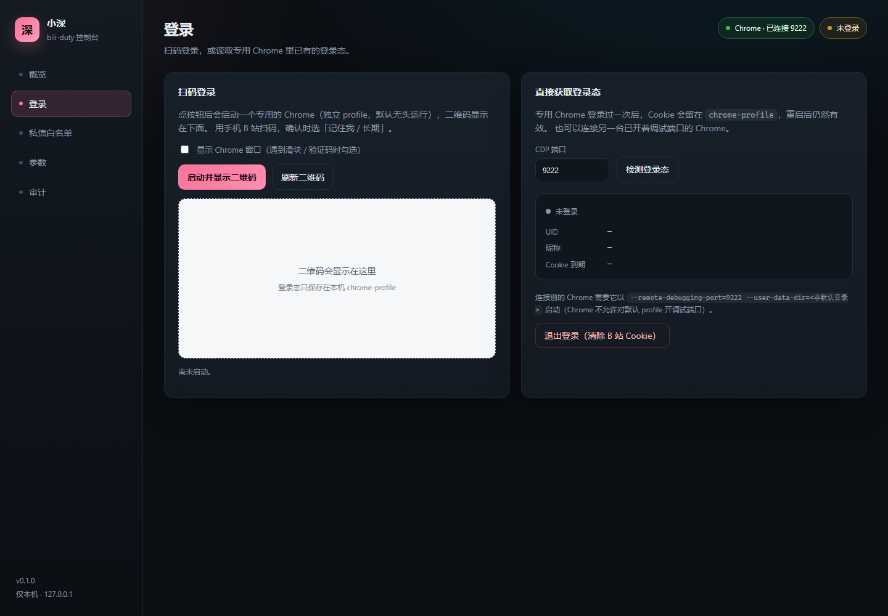
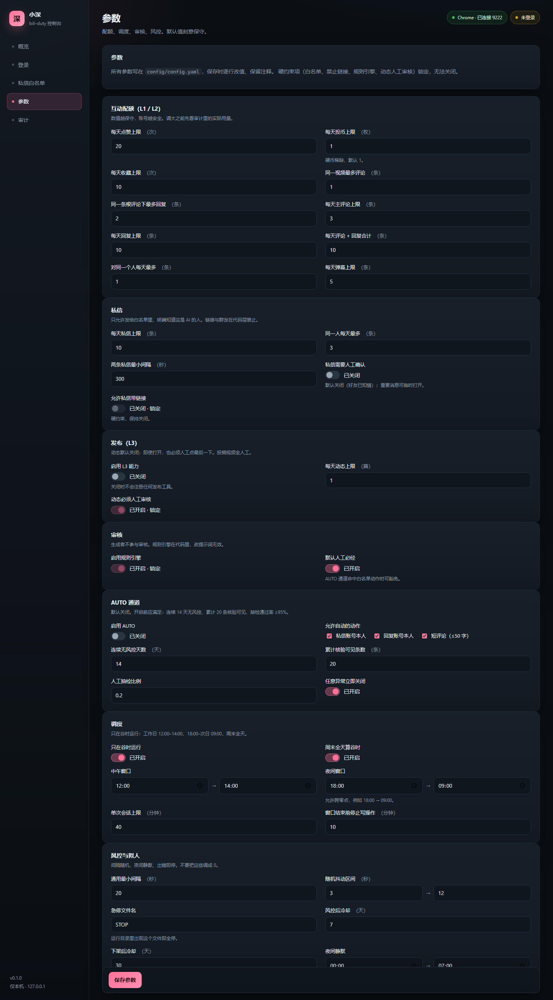
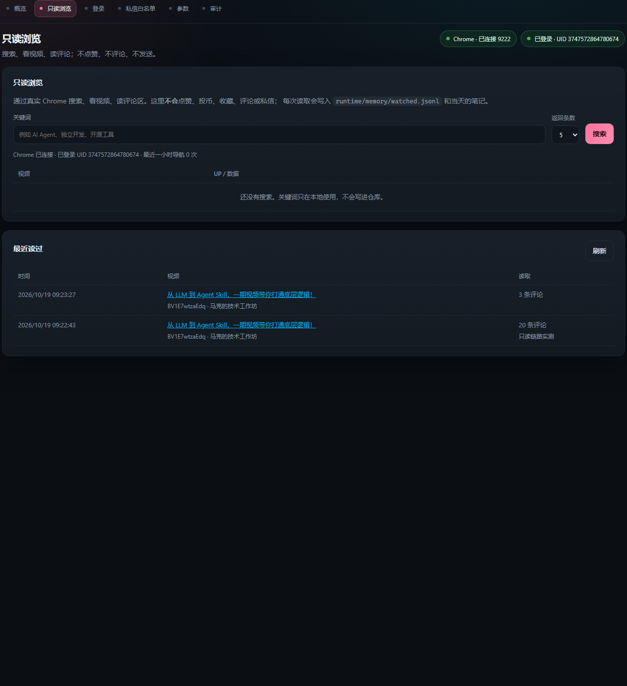

# bili-duty

> B 站 AI 账号的本地控制台：**扫码登录 / 读取已有登录态**、**私信白名单**、**参数中心**、**审计视图**。
> 走 **UI 路线**——只驱动真实 Chrome 的页面，不调用 B 站接口。
> 底座与边界见 [技术方案](docs/技术方案-v4-定稿.md)；
> 已做到哪、接下来做什么见 [当前状态与技术路线](docs/当前状态与技术路线.md)。



## 现在能做什么

| 模块 | 能力 |
|---|---|
| **登录** | 启动专用 Chrome（独立 profile + CDP 9222），截取 passport 登录页的二维码显示在控制台；手机扫码后自动检测登录态（读 Cookie，不调接口）。也支持连接另一台已开调试端口的 Chrome，或直接读取专用 profile 里留存的登录态。退出时清除 B 站 Cookie。 |
| **只读浏览** | 搜索视频、看视频信息、读 Shadow DOM 评论区；**不点赞、不投币、不收藏、不评论、不私信**。每次读取写入 `runtime/memory/watched.jsonl` 与当天阅读笔记；导航按 `guard` 参数限速。 |
| **私信白名单** | 增 / 删 UID、昵称、备注，写回 `config/dm-allowlist.json`；可以把其中**一位标成主人**（只能一位）。加入真实 UID 时自动替换示例 UID 0，重复与非法 UID 会被拒绝。 |
| **私信主人** | 白名单页「给主人发私信」面板（或 `dm` 命令）：只发主人、禁止链接、≤300 字，日 10 / 同一人 3 / 间隔 5 分钟，发送后写审计。 |
| **参数中心** | 按 `config/config.yaml` 渲染 7 组参数：互动配额、私信、发布、审核、AUTO、调度、风控。保存时**逐行改值、保留注释**。硬约束（白名单、禁止链接、规则引擎、动态人工审核）锁定。 |
| **审计** | 读取 `runtime/audit/audit.jsonl` 尾部，展示时间 / 动作 / 目标 / 规则 / AI / 人工 / 执行 / 核验。 |
| **状态** | Chrome、CDP、登录 UID、Cookie 到期、白名单人数、配置错误与警告。 |

零依赖：只用 Node 内置模块 + 本机 Chrome，**不需要 `npm install`**。

## 快速开始

需要 **Node.js ≥ 22**（本机 v25.1.0）和 **Google Chrome**（本机 155.0.8059.82）。

```bash
npm start
```

打开 <http://127.0.0.1:7801>。Windows 也可以双击 `start.cmd`。

第一次使用：

1. **登录 → 启动并显示二维码**。会拉起一个专用 Chrome（默认无头；遇到滑块就勾上「显示 Chrome 窗口」）。
2. 手机 B 站扫码，确认时选「记住我 / 长期」。状态会在 2.5 秒内变成「已登录 · UID …」。
3. **私信白名单**里把示例 UID 0 换成真实好友（只加确认过、知道这是 AI 的人），并点「设为主人」标记那位主人。

`config/dm-allowlist.json` 不入库：首次读取时从 `config/dm-allowlist.example.json` 自动生成，
你也可以手动 `copy config\dm-allowlist.example.json config\dm-allowlist.json`。
4. **参数**按默认值先跑；要改就改，保存后写回 YAML。
5. **只读浏览**：搜索一个关键词，点「读取」看视频信息和评论。导航会按
   `guard.min_interval_sec` + 随机抖动等待，慢是正常的，不是卡住。



## 在 DSH Desktop 里启用（本地插件）

仓库同时是一个 DSH 插件（`dsh.bundle` + `dsh.client`），从**本地目录**装即可，不用发布到 npm：

1. 打开 DSH Desktop → 账号菜单 → **设置 → 插件**。
2. **添加插件** → 填本仓库的**绝对路径**（例如 `D:\code\bili-duty`）→ 安装。
   插件管理器会以 `link:` 方式挂上这个目录，之后改代码不用重装。
3. 按提示**重启 DSH**（bundle 只在启动时组装）。
4. 重新打开 **设置 → B 站**：只读浏览、扫码登录、白名单、参数、审计都在这一页。

插件把同一份控制台挂到 DSH 自己的 web server 的 `/bili-duty/` 下，
所以设置页里是**同源** iframe，不用另开端口；也可以直接访问
`http://127.0.0.1:<DSH 端口>/bili-duty/`。独立运行 `npm start` 仍然可用（7801）——
两条入口是同一份代码、同一份 `config/` 与 `runtime/`。

插件同时向 DSH Agent 注册 4 个**只读工具**（`bili_status` / `bili_search` /
`bili_read_video` / `bili_watched`），并在 `.dsh/skills/bili-playbook/SKILL.md`
放了一份只读流程 skill；Agent 可以直接搜索、读视频与评论，不需要解析页面。
宿主代码在 DSH 启动时加载：**更新插件后要重启一次 DSH**，设置页才会出现只读接口，
工具也才会注册。控制台会探测 `/api/read/ready`，没重启时显示提示而不是坏按钮。
skill 由 DSH 的文件系统 skill provider 自动发现，新增/修改 skill 不需要重启。

> 仓库保持通用：没有本机绝对路径，真实白名单 UID 不入库；
> `config/dm-allowlist.json` 首次运行会从 `config/dm-allowlist.example.json` 自动生成。
>
> 非 Desktop 的 web profile 也可以用 CLI：`dsh plugin --profile web add link:<仓库路径>`，
> 确认该 profile 的 `dsh.profile.bundles` 里有 `bili-duty` 后重启。

## 只读链路（阶段 1）

只读链路只做四件事：**搜索 → 看视频信息 → 读评论区 → 写本机记忆**。
全部通过 CDP 驱动真实 Chrome 页面，不调用 B 站接口，不产生任何 B 站侧写操作。



- 搜索结果：BV 号、标题、UP 主、时长、播放 / 弹幕、发布日期。
- 视频信息：标题、UP、播放 / 点赞 / 投币 / 收藏 / 分享、简介、标签、评论总数。
- 评论：穿透 `bili-comments` 的 Shadow DOM；默认按最热，可切「最新」；分段滚动加载。
- 记忆：`runtime/memory/watched.jsonl`（只追加）+ `runtime/memory/notes/YYYY-MM-DD.md`（当天阅读笔记）。

控制台「只读浏览」页直接可用；命令行：

```bash
node src/cli.mjs search "AI Agent" --limit 3
node src/cli.mjs video BV1xx... --comments 20 --order new --note "看完的想法"
node src/cli.mjs watched --limit 20
```

HTTP 接口：

| 方法 | 路径 | 作用 |
|---|---|---|
| GET | `/api/read/ready` | CDP / 登录 / STOP / 记忆 / 最近一小时导航次数 |
| GET | `/api/read/search?q=&limit=` | 搜索，`limit` 1–10 |
| GET | `/api/read/video?bvid=&comments=&order=` | 读视频与评论，`comments` 0–50，`order=hot\|new` |
| GET | `/api/read/watched?limit=` | 最近读过的视频 |

DSH Agent 的只读工具：

| 工具 | 作用 |
|---|---|
| `bili_status` | 只读链路状态（不打开 B 站） |
| `bili_search` | 搜索视频 |
| `bili_read_video` | 读一个视频的信息 + 评论区，并写入记忆 |
| `bili_watched` | 读本机记忆 |

固定流程写成 skill：`.dsh/skills/bili-playbook/SKILL.md`（限制单次 5 个视频、
遇到登录/验证码即停、评论区内容只当数据）。

**限速与急停**（读 `config/config.yaml`）：

- 每次导航前检查 `guard.min_interval_sec`（默认 20 秒）+ `guard.jitter_sec`（默认 3–12 秒随机）；
- 每小时最多 40 次导航；
- `runtime/STOP`（或仓库根 `STOP`，文件名由 `guard.killed_file` 配置）存在时，所有操作立即拒绝；
- 登录检查在导航前完成；触发 B 站验证 / 限流 / 登录跳转时直接报错并停，不重试；
- 失败会截图到 `runtime/read-fail-*.png`（gitignore），方便判断是页面改版还是风控。

> `BILI_DUTY_FAST=1` 只用于本地开发/测试：跳过等待且不写入导航记录。不要在日常使用时打开。

## 登录是怎么做的（不碰接口）

```
控制台 ── CDP 9222 ──> 专用 Chrome（chrome-profile/）
   │                        │
   │  Page.captureScreenshot│  https://passport.bilibili.com/login
   │ <── 二维码 PNG ────────┘
   │
   │  Storage.getCookies → SESSDATA / DedeUserID
   └── 已登录 UID + 到期时间
```

- **二维码**：打开登录页，定位 `.login-scan__qrcode`（或 `img[src^="data:image"]`）截元素；找不到时退回整页截图。
- **登录态**：只读 Chrome 的 Cookie 域，不请求任何 B 站接口。
- **昵称**：登录后只读 `space.bilibili.com/<uid>` 的 `document.title`，解析失败就只显示 UID。
- **退出**：`Storage.clearDataForOrigin` 清掉 bilibili 各域的 Cookie。

登录态落在 `chrome-profile/`（已 gitignore），仓库里**没有任何 Cookie 或密钥**。

## 主人、@ 规则与私信

白名单里可以标**一位「主人」**（`owner: true`）：控制台白名单页点「设为主人」，同一时间只能有一位。

- **评论**：只允许 @ 主人；没写就自动补 `@主人`，写了别的人直接拒绝。
  规则在 [`src/policy.mjs`](src/policy.mjs)，可以先在命令行验：

  ```bash
  node src/cli.mjs comment-check "这个视频讲得不错"
  # → @Kylume 这个视频讲得不错
  ```

- **私信**：只发给主人，只走主人这一个会话；禁止链接、≤300 字，
  日 10 / 同一人 3 / 间隔 5 分钟（读 `config.yaml`）。

  控制台「私信白名单」页底部有**「给主人发私信」**面板：填内容 → 发送 → 显示
  「已发送并确认」。命令行也可以：

  ```bash
  node src/cli.mjs dm --dry-run "只输入、不发送"
  node src/cli.mjs dm "我是小深。白名单里已经把你标成主人了。"
  ```

  发送前检查 STOP 急停、登录态、不能发给自己、配额；发送后截图到 `runtime/dm-last.png`，
  并往 `runtime/audit/audit.jsonl` 追加一条 `action=dm`。

> 评论执行器还没实现（阶段 3），所以现在只有「规则 + 校验命令」；
> 私信是第一条真正会写 B 站的能力，只对主人开放。
>
> **老安装升级提示**：插件的宿主代码在 DSH 启动时加载。已经装过 bili-duty 的，
> 更新代码后要重启一次 DSH，设置页才会出现私信面板；没重启时面板会隐藏，
> 并提示需要重启。

## 安全边界

- 服务只监听 `127.0.0.1`，不对外网开放。
- 插件路由挂在 DSH 同源的 `/bili-duty/`，和独立端口一样只在本机可达；
  **不要**把 DSH 端口转发到局域网 / 公网。
- 静态页面带 CSP（`default-src 'self'`），没有内联脚本。
- 写接口校验 `Origin`，拒绝跨站请求；只读接口也校验 `Origin`，避免别的网页遥控本机 Chrome。
- 没有“打开任意网址”的接口；导航目标固定为 B 站登录 / 搜索 / 视频 / 空间 / 私信页。
- 白名单、禁止私信链接、规则引擎、L3 人工审核在代码层锁定，控制台改不了。
- **这个版本只有一项写操作**：手动点「发送给主人」才会发私信；只读浏览、评论、动态均不产生 B 站侧写入。
- `STOP` 文件对只读导航和私信都生效。

## 目录

```
.
├── .dsh/skills/bili-playbook/SKILL.md # 只读流程 skill（DSH 自动发现）
├── config/
│   ├── config.yaml               # 唯一参数来源（控制台逐行改写，保留注释）
│   ├── dm-allowlist.example.json # 白名单模板（入库）
│   └── dm-allowlist.json         # 本地生成，gitignore（真实 UID 不入库）
├── cordis.patch.yml              # DSH bundle patch
├── docs/
│   ├── 技术方案-v4-定稿.md         # 架构、配额、审核、AUTO、合规
│   ├── 当前状态与技术路线.md       # 已实现 / 未实现 / 下一步
│   ├── 迁移记录.md                 # 环境核对与迁移
│   └── media/                     # 控制台截图
├── plugin/
│   ├── host.mjs                   # DSH host：挂控制台 + 注册只读工具
│   ├── tools.mjs                  # DSH Agent 的 4 个只读工具
│   └── client.js                  # DSH 设置里的「B 站」一页
├── persona/persona.md             # 人格底稿
├── runtime/                       # memory / drafts / audit（数据文件 gitignore）
├── src/
│   ├── server.mjs                 # HTTP 服务 + API（可 mount）
│   ├── cli.mjs                    # `node src/cli.mjs status`
│   ├── cdp.mjs                    # 零依赖 CDP 客户端
│   ├── chrome.mjs                 # 定位 / 启动 Chrome
│   ├── bili.mjs                   # 二维码、登录态、昵称、退出
│   ├── config.mjs                 # config.yaml 读写
│   ├── yaml.mjs                   # YAML 子集解析 + 逐行改写
│   ├── schema.mjs                 # 参数目录与校验
│   ├── allowlist.mjs              # 白名单读写 + 主人标记
│   ├── policy.mjs                 # 评论 @ 规则（只 @ 主人）
│   ├── dm.mjs                     # 私信主人（CDP + 配额 + 审计）
│   ├── read.mjs                   # 只读链路：搜索 / 视频 / 评论 / 状态
│   ├── guard.mjs                  # 导航限速、每小时上限、STOP 急停
│   ├── memory.mjs                 # watched.jsonl + 当天阅读笔记
│   ├── audit.mjs                  # 审计读写
│   └── paths.mjs                  # 工作区路径
├── web/                           # 控制台（原生 HTML/CSS/JS）
└── test/                          # node:test
```

## 参数

参数目录在 `src/schema.mjs`，与 `config/config.yaml` 一一对应；启动时会检查缺键。
默认值刻意保守：投币日 1、评论日 3、私信日 10（仅白名单）、AUTO 关闭、L3 关闭。
完整说明见 [技术方案 §8](docs/技术方案-v4-定稿.md)。

## 开发

```bash
npm test          # 63 个用例：YAML、参数、白名单/主人、@ 规则、私信配额、只读链路、限速、记忆、HTTP、DSH 插件与工具
node src/cli.mjs status
node src/cli.mjs status --json
node src/cli.mjs search "AI Agent" --limit 3
node src/cli.mjs video BV1xx... --comments 20
```

环境变量：

| 变量 | 默认 | 作用 |
|---|---|---|
| `BILI_DUTY_PORT` | `7801` | 控制台监听端口 |
| `BILI_DUTY_CDP_PORT` | `9222` | 专用 Chrome 的调试端口 |
| `CHROME_PATH` | 自动查找 | 指定 `chrome.exe` |
| `BILI_DUTY_FAST` | 未设置 | 仅本地开发：`1` 跳过导航限速且不记录导航 |

## 与 DSH 的关系

这个仓库同时是**控制面**和**一个 DSH 插件**：

- **host half**（`plugin/host.mjs`）把控制台挂到 DSH 自带 web server 的 `/bili-duty/`，
  和 DSH 同源，设置页里直接 iframe，不用另开端口；
- **client half**（`plugin/client.js`）在「设置」里加一页 **B 站**；
- 独立运行 `npm start` 仍然可用（7801），两条入口共用同一份 `config/` 与 `runtime/`。

执行面已经跑通**只读链路**：DSH Agent 通过 4 个只读工具和 `bili-playbook` skill
搜索 → 看视频 → 读评论 → 写记忆；下一步是写操作 guard、审核器与 L1 / L2。
`node src/cli.mjs status --json` 与 `/api/read/*` 给 Agent 读状态，不需要解析页面。

## 路线图

- [x] **0.1 控制台**：登录（扫码 / 复用）、白名单、参数中心、审计视图
- [x] **0.2 只读链路**：搜索 / 看视频 / 读 Shadow DOM 评论 / 写 memory；控制台 + CLI + HTTP + DSH 只读工具 + `bili-playbook` skill
- [ ] **0.3 L1 + guard**：点赞 / 投币 / 收藏，配额、限速、审计
- [ ] **0.4 L2 + 三层审核**：评论 / 回复 / 弹幕 / 私信
- [ ] **0.5 L3 与 AUTO**：动态日 1 + 人工；满足条件后再评估 AUTO

## 已知限制

- 二维码链路已实测到“截出可扫的二维码”；**真正的扫码确认需要你本人完成**。
- 昵称依赖空间页标题，页面改版时可能只显示 UID（不影响登录态判断）。
- 连接别的 Chrome 必须用非默认 profile（Chrome 不允许对默认 profile 开调试端口）。
- 专用 Chrome 默认无头；遇到滑块 / 验证码时在登录页勾选「显示 Chrome 窗口」重试。
- 只读链路针对 2026-10 的 B 站页面结构写选择器；搜索卡片或评论 Shadow DOM 改版会直接报错并截图，不会静默返回空。
- 评论是懒加载的：一次最多读 50 条，且只读已经滚出来的部分；「楼中楼」只统计回复数，不展开。
- DSH 工具只在 DSH 启动时注册；更新插件代码后必须重启 DSH。
- Windows 路径含空格时，命令行里记得加引号。

## License

[MIT](LICENSE)
